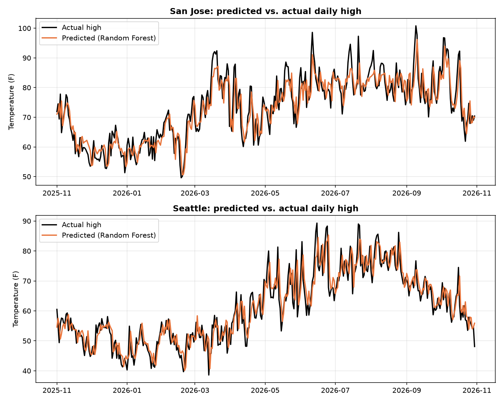
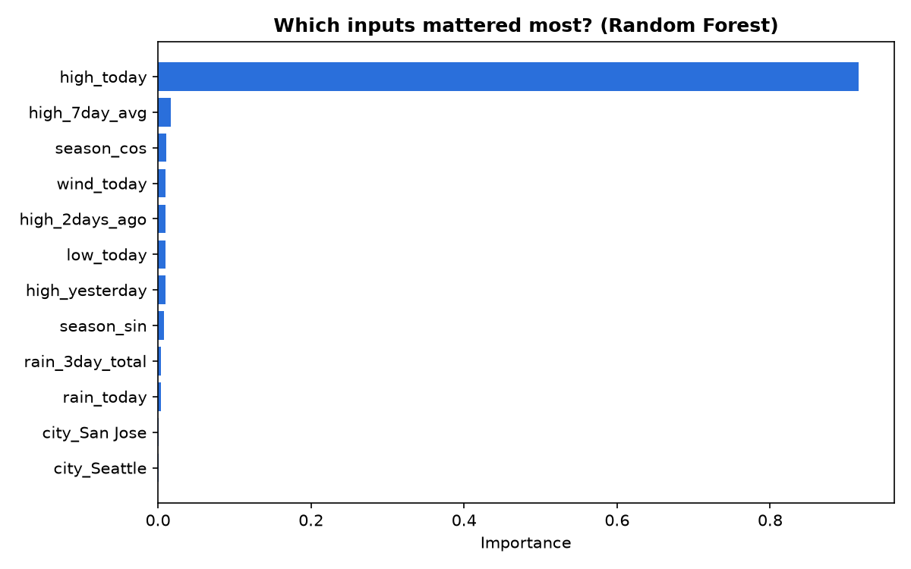

# Predicting Tomorrow's High Temperature

A machine learning project that predicts the next day's high temperature for San Jose, CA
and Seattle, WA from recent weather, and checks honestly whether the models beat simple
baselines.

## What it does
- `collect_data.py` pulls five years of daily weather for both cities from the free
  [Open-Meteo Historical Weather API](https://open-meteo.com/en/docs/historical-weather-api)
  and saves it to `weather_data.csv` (3,652 rows)
- `predict_temperature.py` builds features, trains two models, and compares them with two baselines
- Saves a results table and two charts

## Approach
- **Features (the inputs):** today's high and low, the previous two days' highs, the 7-day
  average high, rain today and over 3 days, wind, time of year, and which city
- **Target (the answer):** tomorrow's high temperature
- **Time-based split:** trained on the past (up to Oct 30, 2025) and tested on the most recent
  year (Oct 31, 2025 onward, 728 rows). Data is never shuffled, so the test is a fair
  "predict the future" test.
- **Baselines:** "tomorrow will be the same as today" and "tomorrow will be that city's
  average for the month"
- **Models:** Linear Regression and Random Forest (scikit-learn)
- **Metrics:** MAE (average error in degrees F), RMSE, and R-squared

## Results

| Method | MAE (F) | RMSE (F) | R2 | MAE San Jose | MAE Seattle |
|---|---|---|---|---|---|
| **Random Forest** | **3.51** | 4.55 | 0.88 | 3.63 | 3.40 |
| Linear Regression | 3.55 | 4.55 | 0.88 | 3.80 | 3.31 |
| Baseline: same as today | 3.74 | 4.91 | 0.86 | 3.80 | 3.68 |
| Baseline: monthly average | 5.55 | 7.25 | 0.68 | 6.31 | 4.79 |

**Takeaways**
- Both models beat both baselines. The best is about 6% more accurate than "same as today"
  and far more accurate than the monthly average.
- Random Forest and Linear Regression are effectively tied (0.04 F apart), and Linear
  Regression was better in Seattle.
- The gain over "same as today" is modest: day-to-day temperature is already highly
  persistent, so today's weather is a strong predictor on its own.




## How to run
```
python3 -m venv .venv
source .venv/bin/activate
pip install -r requirements.txt
python collect_data.py
python predict_temperature.py
```

## Limitations and next steps
- Only two cities and five years of data
- Open-Meteo provides modeled (reanalysis) grid data, not thermometer readings, so extremes
  can differ from official station records
- Only uses past weather, not weather-forecast models, and only predicts one day ahead
- Ideas: predict rain vs. no rain, forecast 2 to 7 days ahead, add more cities and years,
  and test more models

## Tools
Python, pandas, scikit-learn, matplotlib, requests

## Data
Weather data by [Open-Meteo.com](https://open-meteo.com/) (CC BY 4.0).
